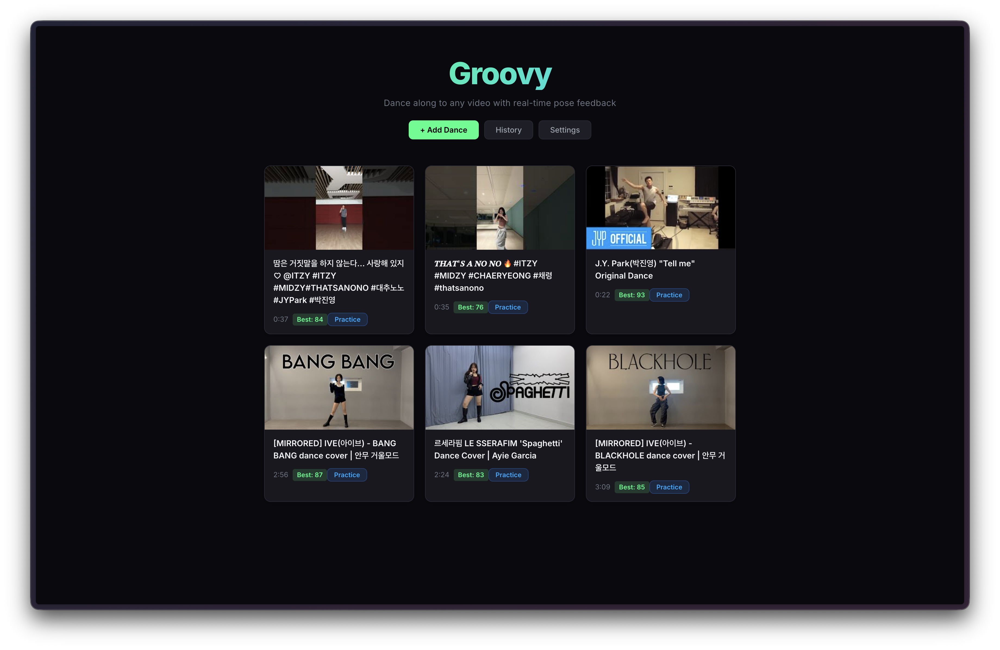

# DanceCraft

A webcam dance challenge where Claude turns your performance scores into a focused practice plan, so you can retry and beat the host.

DanceCraft extends [Groovy by JoeyWangTW](https://github.com/JoeyWangTW/groovy), under the original MIT license. It adds a host challenge, a local leaderboard, a Claude coach, executable practice drills, and replay evidence. One dancer plays at a time; the leaderboard stays in the current browser.

## DanceCraft demo

1. Import a short reference video and choose its Mirror setting.
2. Dance with the webcam. Review the score, tracking coverage, movement evidence, and your saved clip.
3. Ask the coach for a section, playback speed, repetition count, and a cue. The Practice button applies that drill.
4. Retry the full dance and compare with your previous attempt and the host.

The motion engine calculates scores. The Anthropic API receives structured score summaries and tracking evidence, then returns a practice plan and battle commentary. Webcam video is not part of the Claude request. The app can store recordings on its own backend for session history.

## Run locally

Use Node.js 24, Python 3.11, FFmpeg, and yt-dlp. Install JavaScript dependencies with `npm install`, then follow [the DanceCraft setup and runbook](docs/dancecraft.md). On Windows, `scripts/setup-windows.ps1` prepares the Python environment; `start-dancecraft.cmd` launches the app. Copy `.env.example` to `.env` for local settings. Keep the API key on the Express backend.

`npm run dev` starts the frontend and backend. For a production build on a different backend port, set `VITE_API_BASE` at build time, for example `http://localhost:3002`. The presentation laptop currently uses frontend port 5174 and backend port 3002.

## Verified status on 2026 October 15

The integrated app passes 524 unit tests, TypeScript checks, a production build, and the two coach browser tests. Changed files pass ESLint with existing DanceMode hook warnings; the full repository still has older lint errors and obsolete browser baselines.

The post-dance scorer uses the held-out winner from the scoring experiment: body-segment directions, movement hits, bounded timing, visibility penalties, and reference video geometry. It passed 39 target checks and 28 rank checks on each of two previously unseen seeds. Those checks use synthetic variations of one reference and three existing still-person recordings. They do not establish human dance accuracy or fairness across dancers and camera viewpoints.

The Claude API integration is implemented. The configured Anthropic account currently rejects live requests because its credit balance is too low. The UI labels the built-in coach when that fallback responds. A successful paid Claude call and a real-webcam rehearsal of the final build remain necessary before claiming an end-to-end live Claude demo.

## Attribution

Original dance engine: JoeyWangTW / Groovy, MIT. DanceCraft builds on its video import, MediaPipe tracking, key-pose feedback, recording/replay, and practice controls. Original copyright and license remain in [LICENSE](LICENSE). Local videos, recordings, credentials, virtual environments, and downloaded model files are excluded from this repository.

---

## Original Groovy documentation

Open-source, browser-based dance game. Dance along to any YouTube video with real-time pose detection, scoring, and post-dance replay review. Think "Just Dance" but for any video, running entirely in the browser.



## How It Works

1. **Add a dance** — paste any YouTube URL (regular videos or Shorts) and Groovy downloads it, extracts the reference poses offline using MediaPipe BlazePose Heavy
2. **Dance** — the reference video plays full-screen while your webcam tracks your pose in real-time using MediaPipe BlazePose Full (GPU-accelerated, 120+ FPS)
3. **Score** — joint angle comparison with spatial awareness scores each key pose as you hit it, with instant feedback
4. **Replay** — watch your recording side-by-side with the reference, skeleton overlays, per-joint scoring breakdown, and color-coded timeline

## Features

- Real-time 33-landmark pose estimation via MediaPipe BlazePose (GPU-accelerated)
- Joint angle + spatial scoring with deduction-based grading (S/A/B/C ranks)
- Presence and movement detection to prevent gaming the score
- Practice mode with adjustable speed, loop sections, and ghost overlay
- Per-dance mirror toggle for videos filmed from the dancer's perspective
- Key pose editor to customize scoring checkpoints
- YouTube Shorts and vertical video support
- Session history with replay from saved recordings

## Hardware Requirements

Groovy runs real-time pose estimation on your GPU via WebGL. It has been developed and tested on a **MacBook Pro with M3 Max**.

**Minimum:**
- A machine with a dedicated or integrated GPU that supports WebGL 2.0
- Webcam
- Modern browser (Chrome or Edge recommended for best WebGL/MediaPipe performance)

**Notes:**
- Pose estimation runs at 120+ FPS on M3 Max. Performance will vary on other hardware.
- The offline pose extraction pipeline (Python/MediaPipe Heavy) is CPU-bound and takes roughly 1-2x the video duration to process.

## Setup

### Prerequisites

- [Node.js](https://nodejs.org/) v20+
- [Python](https://www.python.org/) 3.10+
- [yt-dlp](https://github.com/yt-dlp/yt-dlp) (available on PATH)
- [ffmpeg](https://ffmpeg.org/) (available on PATH)

### Install

```bash
git clone https://github.com/JoeyWangTW/groovy.git
cd groovy

# Install Node dependencies
npm install

# Set up Python virtual environment for the offline pose pipeline
python3 -m venv .venv
source .venv/bin/activate
pip install mediapipe opencv-python-headless numpy yt-dlp

# Download the MediaPipe pose model
curl -o scripts/pose_landmarker_heavy.task \
  https://storage.googleapis.com/mediapipe-models/pose_landmarker/pose_landmarker_heavy/float16/latest/pose_landmarker_heavy.task
```

### Run

```bash
npm run dev
```

This starts both the frontend (Vite, `http://localhost:5173`) and backend (Express, `http://localhost:3001`).

Open the frontend URL, add a YouTube dance video, and start dancing.

### Scripts

| Command | Description |
|---|---|
| `npm run dev` | Start frontend + backend concurrently |
| `npm run dev:frontend` | Start Vite dev server only |
| `npm run dev:backend` | Start Express backend only (with file watching) |
| `npm run build` | TypeScript check + production build |
| `npm test` | Run unit tests (Vitest) |
| `npm run test:e2e` | Run end-to-end tests (Playwright) |

### Configuration

| Variable | Default | Description |
|---|---|---|
| `PORT` | `3001` | Backend server port |
| `CORS_ORIGIN` | `http://localhost:*` | Allowed CORS origin pattern |
| `PYTHON_PATH` | `.venv/bin/python3` | Path to Python binary |
| `DATA_DIR` | `data/dances` | Where downloaded videos and poses are stored |

## Scoring

Scoring uses a three-layer system to prevent inflated scores:

1. **Presence gate** — requires 6 of 8 core keypoints visible at sufficient confidence
2. **Movement energy gate** — blends angular velocity (60%) and positional velocity (40%) over a 1.5s rolling window. Standing still = automatic miss.
3. **Torso-relative spatial comparison** — compares bone segment directions relative to the torso frame, catching poses with similar angles but different spatial configs

Final score: `0.6 * angleScore + 0.4 * spatialScore`, with deduction-based grading (start at 100, subtract penalties per joint).

**Ranks:** S (75%+), A (55%+), B (35%+), C (<35%)

## Tech Stack

| Layer | Technology |
|-------|-----------|
| Frontend | React, TypeScript, Vite |
| Backend | Node.js, Express, SQLite (better-sqlite3) |
| Pose (browser) | MediaPipe BlazePose Full (`@mediapipe/tasks-vision`, GPU) |
| Pose (offline) | MediaPipe BlazePose Heavy (Python, highest accuracy) |
| Video pipeline | yt-dlp, ffmpeg |
| Scoring | Joint angle comparison, spatial comparison, DTW alignment |
| Recording | MediaRecorder API with canvas compositing |
| Tests | Vitest (195 unit tests), Playwright (65+ e2e tests) |

## Project Structure

```
src/
  components/     # React UI (DanceMode, PracticeMode, ReplayMode, etc.)
  scoring/        # Scoring algorithms (comparison, DTW, key pose detection, presence, movement)
  pose/           # Browser-side pose detector wrapper
  storage/        # LocalStorage helpers (settings, scores)
server/
  app.ts          # Express app with CORS and static file serving
  db.ts           # SQLite database (dances, sessions)
  processing.ts   # Video download + pose extraction pipeline
  routes/         # API routes (dances CRUD, sessions, jobs)
scripts/
  extract_poses.py  # Offline pose extraction (MediaPipe Heavy + post-processing)
```

## Known Limitations & Future Work

- **Scoring is too forgiving** — current thresholds make it easy to get S-rank. Needs calibration with more diverse dancers and difficulty levels.
- **Heavy hardware requirements** — real-time BlazePose Full at high FPS needs a strong GPU. Exploring lighter models (e.g. BlazePose Lite) that can still deliver acceptable quality.
- **Single person only** — multi-person tracking is planned but not yet implemented.

## License

MIT
