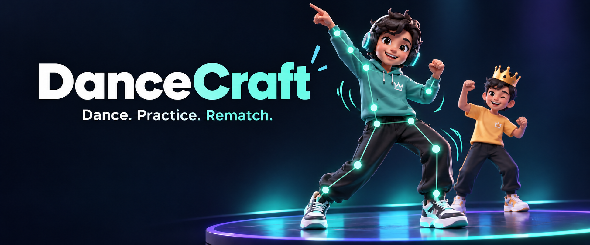
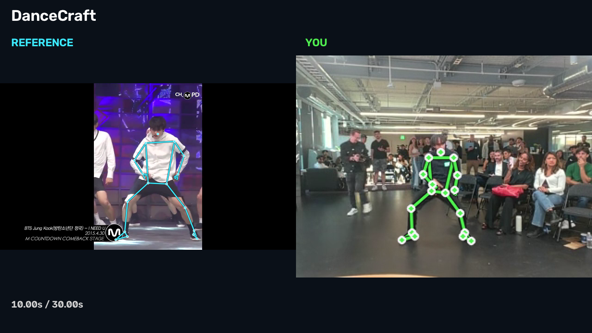
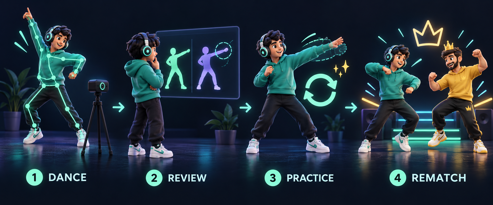

# DanceCraft



**A webcam dance challenge where Claude turns your scores into a focused practice plan, so you can retry and beat the host.**

Most of the DanceCraft product experience was rebuilt and extended with **Claude Code**, including the challenge UI, coaching, practice drills, results, replay review, and calibrated post-dance scoring.

## Watch the demo

[](demo/DanceCraft_04_Synced_With_Audio.mp4)

**[Watch or download the promotional replay](demo/DanceCraft_04_Synced_With_Audio.mp4)**

A saved dance attempt beside the reference, with skeleton overlays and music. This legacy recording uses a fixed editorial timing adjustment; the original recording and scores are unchanged.

## The challenge

Pick a short dance, follow it on your webcam, and chase the host's score. Review where you lost points, practice a section with the coach, then come back for a rematch.



*Original AI-generated artwork for this README. The illustrations represent the experience; the app uses 2D characters.*

1. **Dance.** Import a reference video, choose its Mirror setting, and follow along with webcam pose tracking and live key-pose feedback.
2. **Review.** See section and body-part scores, tracking coverage, and a clear explanation of the result. Replay aligns your saved clip with the reference using music and recording timestamps captured during the dance.
3. **Practice.** Claude chooses a section, speed, repeat count, and concrete cue from the scoring evidence. The Practice button runs that drill.
4. **Rematch.** Compare with your last attempt and challenge the host again. The local leaderboard keeps the score to beat visible.

## Rebuilt with Claude Code

The rebuild focused on the parts that turn dance tracking into a coached challenge:

- **Arena and characters:** a new home hero, dancing character guide, named players, a host challenge, and a local leaderboard.
- **Coaching:** a backend Claude integration that turns measured performance into a structured practice plan and grounded battle commentary.
- **Practice and replay:** executable section loops, repetition counting, per-video Mirror controls, inline clip playback, and larger side-by-side review.
- **Results and scoring:** a new explanation panel, movement and framing evidence, and a calibrated post-dance scorer selected against competing designs and baselines.

We retained the pose-tracking and video-processing foundation and substantially reworked the experience around it. Claude Code supported development; the Claude API powers the in-app coach when configured.

## What Claude does

The motion engine computes the score. Claude receives timestamped section scores, body-part scores, tracking coverage, movement evidence, and previous/host attempts when available. It returns a practice section, playback speed, repetition count, and coaching cue.

The coach addresses low movement and poor framing before technique advice and avoids judging body parts that were out of frame. Battle commentary follows the measured scores; the app determines the winner.

API keys stay on the Express backend. Claude requests contain structured scores, not webcam video. Recordings can be stored by the app's own backend for History and replay. A labeled built-in coach handles missing credentials or failed API requests.

## Demo and presentation

The saved demo shows a real recorded attempt with both skeleton overlays and reference music. This legacy clip uses a constant editorial timing adjustment; the raw recording and score data are unchanged. It demonstrates performance review rather than a live Claude response. See the [timing investigation and export guide](docs/video-sync.md).

| Artifact | File |
| --- | --- |
| Synced replay with skeletons and music | [Watch or download](demo/DanceCraft_04_Synced_With_Audio.mp4) |
| Camera recording | [Video](demo/DanceCraft_01_Camera.mp4) |
| Camera with skeleton | [Video](demo/DanceCraft_02_Camera_Skeleton.mp4) |
| Reference with music | [Video](demo/DanceCraft_03_Reference.mp4) |
| Reference with skeleton and music | [Video](demo/DanceCraft_05_Reference_Skeleton.mp4) |
| Three-minute pitch | [PowerPoint](docs/presentation/DanceCraft_Final_Presentation.pptx) |

## Run locally

Prerequisites: Node.js 24, Python 3.11, and FFmpeg. The Windows setup script installs the project dependencies, creates the Python environment, installs yt-dlp, and downloads the pose model.

```powershell
git clone https://github.com/jink-ucla/DanceCraft.git
cd DanceCraft
powershell -ExecutionPolicy Bypass -File scripts/setup-windows.ps1
.\start-dancecraft.cmd
```

For Claude coaching, set `ANTHROPIC_API_KEY` in your local `.env` and use an available `COACH_MODEL`. The backend reads the key. The built-in coach works without a key.

By default, `npm run dev` starts Vite on port 5173 and Express on port 3001. If the backend uses another port, set `VITE_API_BASE` before starting or building the frontend. The current presentation laptop uses frontend port 5174 and backend port 3002.

See the [setup and demo runbook](docs/dancecraft.md) for configuration and rehearsal steps.

## Stack and validation

React, TypeScript, and Vite power the UI. Express and SQLite manage the library and session history. MediaPipe tracks poses in the browser and extracts reference poses through Python; FFmpeg and yt-dlp handle video processing.

The integrated app passes 531 unit tests, TypeScript checks, a production build, two coach browser tests, and a recording-clock browser regression. The replay exporter also passes nine timing and destination-safety tests. The new post-dance scorer passed 39 target checks and 28 rank checks on each of two unseen seeds. Those checks use synthetic variations of one reference and three still-person recordings; they do not establish broad human dance accuracy or fairness.

The app tracks one dancer at a time, and the leaderboard is local to the browser. Existing repository-wide lint issues and older visual test baselines remain. At the last verification, live Claude calls were blocked by insufficient API credits, so the local demo used the built-in coach. See [current status](docs/status.md) and the [scoring evaluation](docs/scoring-evaluation.md) for details.

## Team

- **M. Wasil Wahi-Anwar:** [Instagram](https://www.instagram.com/wasilwahi/) · [LinkedIn](https://www.linkedin.com/in/m-wasil-wahi-anwar-63027459/)
- **Jin Kim:** [LinkedIn](https://www.linkedin.com/in/jin-kim-17551a107/)

## Credits

Built on [Groovy by JoeyWangTW](https://github.com/JoeyWangTW/groovy), under the [MIT license](LICENSE). Original copyright and license notices are preserved.
